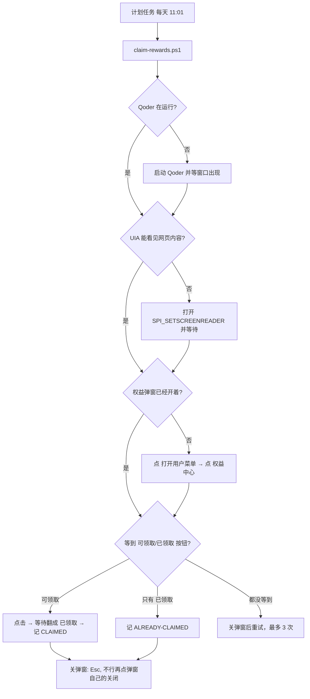

# Qoder 每日权益自动领取

> 每天 11:01 自动打开 Qoder Desktop 的「权益中心」，点掉那个「领取」，把 100 Credits 收下。
> 纯 Windows UI 自动化 —— 不逆向接口、不改客户端、不碰登录态。

<p align="center">
  
  &nbsp;&nbsp;&nbsp;&nbsp;
  
</p>

<p align="center">
  <sub>左：账号菜单里的「权益中心」入口（脚本自动点开）。右：弹窗中每天 100 Credits 那行的领取按钮 —— 就是脚本每天 11:01 要按的那一下。</sub>
</p>

<br>

- **适用**：Qoder Desktop（Windows 版）左下角账号菜单里的「权益中心」每日 Credits
- **原理**：Windows UI Automation 按无障碍名称定位控件并触发 `InvokePattern`，等价于你自己用鼠标点了一下
- **幂等**：当天已经领过就直接跳过，不会重复点击
- **零依赖**：只要系统自带的 Windows PowerShell 5.1，不需要 Python / Node / 第三方模块

---

## 目录

- [为什么要做这个](#为什么要做这个)
- [它是怎么工作的](#它是怎么工作的)
- [环境要求](#环境要求)
- [快速开始](#快速开始)
- [文件说明](#文件说明)
- [配置](#配置)
- [日志与退出码](#日志与退出码)
- [手动跑一次 / 试运行](#手动跑一次--试运行)
- [已知限制](#已知限制)
- [故障排查](#故障排查)
- [卸载](#卸载)
- [免责声明](#免责声明)
- [English](#english)

---

## 为什么要做这个

Qoder Desktop 每天刷新一次可领取的活动权益，点一下就是 100 Credits，领取后 30 天有效。

刷新时间**不是固定的**：一开始是 10:00（UTC+8），后来实际变成 11:00 才发出来。所以脚本默认 11:01，比刷新晚一分钟。这段时间如果又变了，改 `-At` 就行（见[配置](#配置)）。

问题是它不会自己点。忘了领就是忘了领。

所以写了这个脚本：**把「点开账号菜单 → 点权益中心 → 点领取 → 关掉弹窗」这一串人工动作交给系统在每个早上自动做一遍。**

## 它是怎么工作的

### 关键难点：Electron 的界面默认对 UIA 不可见

Qoder Desktop 是 Electron（Chromium）应用。直接遍历它的 UIA 树，你只会拿到几个空壳 `Pane`：

```
Window | Qoder | Chrome_WidgetWin_1
  Pane | Qoder | RootView
    Pane | NonClientView
      Pane | ClientView
        Pane | View
          Pane | View          ← 到此为止，网页内容一个都看不见
```

Chromium 出于性能考虑，**只有在检测到辅助技术时才会构建渲染层的无障碍树**。

解决办法是打开 Windows 的「屏幕阅读器」标志：

```powershell
SystemParametersInfo(SPI_SETSCREENREADER /* 0x0047 */, 0, [ref]$true, SPIF_UPDATEINIFILE | SPIF_SENDCHANGE)
```

大约 3～4 秒后，完整的网页控件树就出来了，而且带着可读的无障碍名称：

```
Button   | 打开用户菜单
MenuItem | 权益中心，有权益待领取     ← 有待领取时会带上数量后缀，所以要按前缀匹配
Button   | 领取                        ← 改版前叫「立即领取」
Button   | 已领取  (IsEnabled = False) ← 领过之后
Group    | 可领取奖励
```

拿到这些名字，剩下的就是标准的 UIA 操作：`ExpandCollapsePattern` 展开菜单，`InvokePattern` 点菜单项和按钮。

**因为走的是 Pattern 而不是坐标点击，所以脚本不需要移动你的鼠标、也不需要窗口在前台。**

### 两个容易踩的坑

**1. 「领取」是「已领取」的子串。**

活动改版后按钮从「立即领取」变成了「领取」。如果按"包含"去匹配，一个已经领过的按钮（`已领取`）会被当成可领取的目标，然后你会对着一个 disabled 的按钮 Invoke，日志报 `CLICKED-UNVERIFIED`。

所以候选标签是**数组**、并且按**全等**匹配：

```json
"claim":   ["领取", "立即领取", "去领取"],
"claimed": ["已领取", "已抢光"]
```

**2. 活动内容是嵌套的远端页面，渲染比弹窗慢得多。**

权益弹窗本身立刻出来，但里面那个 `Document | Qoder Campaign` 是服务端渲染的：行先出现，**按钮要再等十几二十秒**。脚本早期的做法是"20 秒找不到就 Esc 重来"，结果每次都从头重新加载，永远等不到。

现在分两步：先用 `dialogMarkers`（弹窗标题）等它渲染就绪（45 秒上限），再等按钮（`-ClaimTimeoutSec`，默认 75 秒）。

```
Document | Qoder Campaign     ← 嵌套文档，按钮在里面
  Group  | 可领取奖励
  Button | 领取
```

另外，一次 UIA 全树遍历要秒级，所以整组候选标签是**一次遍历**里全部比对完的，不是每个标签各遍历一遍。

### 完整流程



### 为什么不去调 HTTP 接口

一开始确实翻了客户端的 `app.asar`。能搜到 `rewardsCenter: "权益中心"` 这类文案，但领取按钮的文字和请求路径**不在本地包里** —— 权益弹窗的内容是远端下发的，接口形态属于未公开实现。

逆向前端包去拼私有接口，一旦服务端调整就直接失效，而且这类做法通常踩服务条款。**用 UI 自动化模拟自己的点击，行为特征和你手动领是一模一样的**，反而更稳、更干净。

## 环境要求

| 项目 | 要求 |
|---|---|
| 系统 | Windows 10 / 11（依赖 UI Automation 与 System.Drawing 之外的 `user32.dll`） |
| PowerShell | 系统自带的 Windows PowerShell 5.1 即可，无需 PowerShell 7 |
| Qoder | 已安装并已登录 |
| 第三方依赖 | 无 |
| 管理员权限 | **注册时**需要一次提权（见下方说明）；注册完成后日常运行不需要 |
| 登录状态 | 到点时必须是**已登录的交互式会话**（UIA 只能操作有桌面的窗口） |

## 快速开始

```powershell
# 1. 克隆
git clone https://github.com/<your-name>/qoder-daily-rewards.git
cd qoder-daily-rewards

# 2. 先空跑一次，确认能找到按钮（不会真的点）
powershell -NoProfile -ExecutionPolicy Bypass -File .\claim-rewards.ps1 -DryRun

# 3. 注册计划任务：每天 11:01，立即跑一次验证
powershell -NoProfile -ExecutionPolicy Bypass -File .\setup-task.ps1 -At 11:01 -RunNow
```

装完之后，每天早上 11:01 它自己就跑一次。日志在同目录 `claim.log`。

> `setup-task.ps1` 会自己提权（`Start-Process -Verb RunAs`），提权后的子进程负责 `Register-ScheduledTask`，结果通过临时文件回传 —— 因为提权子进程的 stdout 是拿不回来的，只能落盘。

<details>
<summary>为什么要提权？受限令牌下 Register-ScheduledTask 会被拒</summary>

直接在当前 shell 里注册计划任务会失败：

```
Register-ScheduledTask : 拒绝访问。  HRESULT 0x80070005
schtasks /Create       →  拒绝访问
```

即使账户名就叫 `Administrator`。原因不是"权限不够"，而是这个 shell 跑在 **UAC 受限令牌**（UAC-filtered token）里：账户是管理员，但进程拿到的令牌 `IsInRole(Administrator) = False`。

解决办法是让子进程以完整管理员令牌跑：

```powershell
Start-Process powershell -Verb RunAs -WindowStyle Hidden -Wait -ArgumentList '-File','register.ps1'
```

**是否弹 UAC 取决于系统设置。** `ConsentPromptBehaviorAdmin=0`（滑块拉到"从不通知"）时是静默提升；默认设置会弹窗，那时需要你手动点是。本项目的 `setup-task.ps1` 两种情况都能用 —— 有弹窗就点一下。

</details>

<details>
<summary>备选：不想提权的话，用 HKCU 常驻 watcher</summary>

`HKCU\Software\Microsoft\Windows\CurrentVersion\Run` 是用户可写的，不需要提权：

```powershell
powershell -NoProfile -ExecutionPolicy Bypass -File .\install-autostart.ps1 -At 11:01 -StartNow
```

它启动一个常驻进程 `claim-watch.ps1`，每 30 秒比一次时间，到点拉起一次领取，并带命名互斥锁防多开。代价是必须**登录后**才启动、且机器整晚关机就错过；从睡眠恢复后如果当天目标时间已过，它会立刻补跑一次。

两种方式**只开一个**。同时开会在一分钟内点两次弹窗、互相打架。

</details>

## 文件说明

| 文件 | 作用 |
|---|---|
| `claim-rewards.ps1` | 单次领取逻辑。幂等，失败重试 3 次，结束关弹窗 |
| `setup-task.ps1` | **主推**：提权注册 Windows 计划任务（`-At` 改时间、`-RunNow` 立刻跑、`-Remove` 卸载） |
| `uia-lib.ps1` | UIA 封装：找窗口、按名称搜节点、`Invoke`/`Toggle`/`Expand` 点击、无障碍开关、Esc |
| `labels.json` | 界面上的中文文案。**界面改版只改这个文件，不用动脚本** |
| `claim-watch.ps1` | 备选的常驻调度：每 30 秒比一次时间，到点拉起一次领取；带互斥锁防多开 |
| `install-autostart.ps1` | 备选：写 `HKCU\...\Run` 自启项，可选立即拉起 watcher |
| `uninstall-autostart.ps1` | 删自启项并停掉 watcher 进程 |
| `docs/img/` | 本文档用的截图（账号名已打码） |

## 配置

### 改触发时间

```powershell
# 重新注册计划任务（会覆盖同名任务），-At 是 24 小时制
powershell -File .\setup-task.ps1 -At 11:01 -RunNow

# 备选 watcher 路线
powershell -File .\claim-watch.ps1 -At "11:01"
```

权益刷新时间变过（10:00 → 11:00），留 1 分钟余量比较稳。

### 等按钮的耐心值

| 参数 | 默认 | 作用 |
|---|---|---|
| `-ClaimTimeoutSec` | 75 | 等「领取」按钮出现多久（活动 iframe 冷启动要十几二十秒） |
| `-Attempts` | 3 | 整个流程最多重试几次 |
| `-BootTimeoutSec` | 120 | Qoder 没开着时，等它启动多久 |
| `-KeepA11y` | 关 | 跑完不还原 `SPI_SETSCREENREADER` |
| `-DryRun` | 关 | 只找按钮不点 |

### 界面文案变了怎么办

Qoder 更新后按钮文字可能变化。所有中文文案都集中在 `labels.json`：

```json
{
  "menuButton": "打开用户菜单",
  "rewardsCenter": "权益中心",
  "claim": ["领取", "立即领取", "去领取"],
  "claimed": ["已领取", "已抢光"],
  "dialogMarkers": ["专属活动权益", "可领取奖励"],
  "closeButton": "关闭"
}
```

`claim` / `claimed` / `dialogMarkers` 都是**数组**：命中任意一个就算。`claim` 按全等匹配（否则 `领取` 会命中 `已领取`），`dialogMarkers` 按包含匹配（标题可能带数量后缀）。`rewardsCenter` 同样按包含匹配，因为菜单项名字会变成 `权益中心，有权益待领取`。

用 [dbg 手法](#找不到按钮) 打印当前 UIA 树里的真实名称，对上以后改这里即可。

> 注意：脚本本体刻意保持**纯 ASCII**，中文一律从 `labels.json` 以 UTF-8 显式读取。因为 Windows PowerShell 5.1 读无 BOM 的 UTF-8 `.ps1` 会把中文按本地代码页解错，导致匹配永远失败。

### 保留无障碍开关

脚本默认只在「进来时发现树是关的」才打开 `SPI_SETSCREENREADER`，跑完**恢复原状**。加 `-KeepA11y` 可以让它保持开启：

```powershell
powershell -File .\claim-rewards.ps1 -KeepA11y
```

## 日志与退出码

`claim.log` 是每次运行的记录（追加写 UTF-8）；走备选 watcher 路线时还会多一个 `watch.log` 记调度。

真实的一次领取：

```
2026-10-27 11:25:20  --- attempt 1/3 ---
2026-10-27 11:25:21  open user menu via pattern:Expand
2026-10-27 11:25:22  open rewards center via pattern:Invoke
2026-10-27 11:25:24  click claim '领取' via pattern:Invoke
2026-10-27 11:25:26  === CLAIMED ===
```

已经领过的日子：

```
2026-10-27 11:35:01  --- attempt 1/3 ---
2026-10-27 11:35:02  open user menu via pattern:Expand
2026-10-27 11:35:02  open rewards center via pattern:Invoke
2026-10-27 11:35:03  today already claimed
2026-10-27 11:35:04  === ALREADY-CLAIMED ===
```

| 结果 | 退出码 | 含义 |
|---|---|---|
| `CLAIMED` | 0 | 点到按钮且状态翻成「已领取」 |
| `ALREADY-CLAIMED` | 0 | 当天已经领过，跳过 |
| `DRYRUN-CLAIMABLE` | 0 | 空跑，发现可领取但没点 |
| `CLICKED-UNVERIFIED` | 1 | 点了，但 20 秒内状态没变（网络慢或服务端异常） |
| `FAILED` | 1 | 导航失败 / 找不到按钮 |

## 手动跑一次 / 试运行

```powershell
# 空跑：走完导航，只报告会不会点到
powershell -NoProfile -File .\claim-rewards.ps1 -DryRun

# 真跑
powershell -NoProfile -File .\claim-rewards.ps1

# 看计划任务状态与上次结果
powershell -NoProfile -Command "Get-ScheduledTaskInfo -TaskName QoderDailyRewardsClaim | Select-Object LastRunTime,LastTaskResult,NextRunTime"

# 立刻触发一次（不用等到明天）
powershell -NoProfile -Command "Start-ScheduledTask -TaskName QoderDailyRewardsClaim"

# 备选路线：看 watcher 活着没
powershell -NoProfile -Command "Get-CimInstance Win32_Process -Filter ""Name='powershell.exe'"" | Where-Object { $_.CommandLine -like '*claim-watch.ps1*' } | Select-Object ProcessId"
```

## 已知限制

- **到点时必须是登录会话。** 计划任务用的是 `InteractiveToken`：UIA 操作的是桌面窗口，锁屏一般仍可执行，但"无人登录"的会话里没有桌面，点不到任何东西。
- **机器关机时会错过。** 任务勾了 `StartWhenAvailable`，开机/恢复后会补跑一次当天错过的运行 —— 但如果一整天没开机，那天就没了。
- **刷新时间官方会调。** 10:00 变过 11:00。如果连续几天都是 `FAILED`（按钮还没出现），把 `-At` 往后挪。
- **会短暂抢焦点。** 权益弹窗打开后活动页要十几二十秒才渲染出按钮，这段时间屏幕上能看到那个窗口。脚本结束时按 Esc 关掉；Esc 无效时再点弹窗自己的「关闭」（窗口标题栏的同名按钮已被过滤，不会误关 Qoder）。
- **只覆盖「每天领 100 Credits」这一项。** 弹窗里其他活动是「查看详情」，不在自动化范围内。
- **依赖无障碍名称稳定。** Qoder 改版换文案就要更新 `labels.json`。
- **`SPI_SETSCREENREADER` 是全局设置。** 开启期间，机器上其他 Chromium/Electron 应用也会构建无障碍树，可能带来轻微性能开销。脚本跑完会还原，但如果你在它运行时打开了别的浏览器，会受这个影响。
- **脚本路径别乱挪。** 计划任务里写的是绝对路径，挪了目录要重新跑一次 `setup-task.ps1`。

## 故障排查

### 计划任务跑了没 / 为什么没跑

```powershell
Get-ScheduledTask -TaskName QoderDailyRewardsClaim | Select-Object State
Get-ScheduledTaskInfo -TaskName QoderDailyRewardsClaim
```

- `LastTaskResult = 0`：跑成功（不代表领到了，看 `claim.log` 的 `=== ... ===`）
- `LastTaskResult = 1`：脚本报 `FAILED` / `CLICKED-UNVERIFIED`，看 `claim.log`
- `LastTaskResult = 267011`（`0x41303`）：还没跑过
- `LastTaskResult = 2147943726`（`0x800710E0`）：到点时用户没登录，被拒绝运行

### 日志里是 `FAILED`，按钮没等到

两种常见原因，先看 `claim.log` 里最后一句：

| 最后一句 | 含义 | 处理 |
|---|---|---|
| `campaign document never rendered` | 活动 iframe 45 秒都没渲染出标题 | 多半是网络/服务端慢，过一会儿手动再跑一次 |
| `dialog showed no claim or claimed button` | 弹窗出来了但没有可识别的按钮 | 多半是文案改了，对照 [找不到按钮](#找不到按钮) |

### 日志里出现 `renderer a11y still off`

说明无障碍树没建起来。确认 Qoder 真的在运行，然后手动验证：

```powershell
powershell -NoProfile -Command "
Add-Type -Namespace U -Name N -MemberDefinition '[DllImport(\"user32.dll\")] public static extern bool SystemParametersInfo(uint a,uint b,ref bool c,uint d);'
`$v=`$true; [U.N]::SystemParametersInfo(0x0047,0,[ref]`$v,3)"
```

等 5 秒再跑脚本。

### <a id="找不到按钮"></a>找不到按钮

打印当前 UIA 树里所有可点击节点的真实名称，跟 `labels.json` 对：

```powershell
powershell -NoProfile -Command "
. .\uia-lib.ps1
Get-QoderWindows | ForEach-Object {
  Find-AllByName -root `$_ -needle '' |
    Where-Object { 'Button','MenuItem' -contains `$_ .Type } |
    ForEach-Object { '{0,-9} | {1}' -f `$_ .Type, `$_ .Name }
}"
```

### 弹窗没关掉 / 误关了主窗口

脚本先按 Esc，**Esc 关不掉时**才去点弹窗自己的「关闭」按钮（`labels.json` 里的 `closeButton`）。

这里有个必须保留的过滤：Chromium **窗口标题栏**的关闭按钮，无障碍名称也是 `关闭`（`ClassName = WinCaptionButton`）。按名字随手点会把整个 Qoder 关掉。`uia-lib.ps1` 里的 `Find-WebNode` / `Find-AnyWebNode` 都跳过了 `WinCaptionButton`，自己改的时候别把这个过滤去掉。

实测：早先只用 Esc 的版本跑完会把权益弹窗**留在屏幕上**（活动弹窗不响应 Esc），所以补了这层回退。

### 重复运行 / 重复弹窗

- 计划任务用 `MultipleInstances = IgnoreNew`：前一次没结束，这一次直接跳过。
- 备选 watcher 有命名互斥锁 `Local\QoderDailyRewardsClaimWatch`，第二个实例会直接退出。
- 计划任务和 watcher **不要同时装**，否则到点时两个进程会抢同一个弹窗。切换时先卸掉另一个：

```powershell
powershell -File .\setup-task.ps1 -Remove        # 卸计划任务
powershell -File .\uninstall-autostart.ps1       # 停 watcher + 删自启
```

## 卸载

```powershell
# 计划任务（会自动提权）
powershell -NoProfile -ExecutionPolicy Bypass -File .\setup-task.ps1 -Remove

# 备选 watcher 路线
powershell -NoProfile -ExecutionPolicy Bypass -File .\uninstall-autostart.ps1
```

计划任务会从任务计划程序里删掉；watcher 路线会删掉 `HKCU\...\Run\QoderDailyRewardsClaim` 并停掉进程。脚本目录本身可以直接删 —— 它不往系统里装任何东西（`SPI_SETSCREENREADER` 只在运行期间改、跑完还原）。

## 免责声明

这是一个**个人自用**的桌面自动化脚本，作用是替你把每天本来就该自己点一次的那一下点掉。

- 不绕过任何验证码、风控或校验
- 不逆向或调用未公开接口
- 不修改客户端文件、不注入、不破解
- 不给自己多拿额度 —— 每天仍然是那 100 Credits

但请自行确认它与你接受的 Qoder 服务条款不冲突。如果官方明确禁止自动化操作，请停止使用。本项目与 Qoder 官方无关。

MIT 授权，用坏了不负责。

---

## English

A Windows desktop automation that claims the daily **100 Credits** reward inside **Qoder Desktop** every morning at 11:01.

Qoder's rewards center refreshes once a day and offers a claimable credit bundle. The refresh time is not fixed — it started at 10:00 (UTC+8) and later slipped to 11:00 — so the default trigger is 11:01 and `-At` changes it.

**How it works.** Qoder Desktop is an Electron app. Its renderer content is invisible to Windows UI Automation by default — Chromium only builds the accessibility tree when it detects an assistive technology. The script flips the `SPI_SETSCREENREADER` system flag, waits a few seconds, and the full web control tree appears with readable accessible names (`打开用户菜单`, `权益中心`, `领取`). It then drives the UI through `ExpandCollapsePattern` and `InvokePattern`, which means **no cursor movement and no foreground window required**. Finally it dismisses the dialog and restores the system flag.

Two details that are easy to get wrong. The claim label is a **substring of the claimed label** (`领取` inside `已领取`), so candidates are matched exactly rather than by containment. And the dialog body is a **server-rendered nested document** that paints its rows long before its buttons, so the script waits for the dialog header first and only then for the button (45 s + 75 s by default). Pressing Esc alone does not close that modal, so it falls back to the modal's own `关闭` button — window caption buttons share that accessible name and must stay filtered out.

**Why not hit the API instead?** The claim button's label and request path are not present in the client's `app.asar` — the rewards dialog is server-rendered. Reverse-engineering an undocumented endpoint is brittle and a terms-of-service gray area. Simulating your own click is behaviorally identical to doing it by hand.

**Idempotent.** If today's reward is already claimed the button is present but disabled, and the script logs `ALREADY-CLAIMED` and exits 0.

**Scheduling** uses Windows Task Scheduler (`setup-task.ps1`, daily 11:01, `StartWhenAvailable`, `MultipleInstances=IgnoreNew`). Registering a task needs a full admin token, and an ordinary shell is UAC-filtered even when the account is literally named `Administrator` (`Register-ScheduledTask` returns `Access is denied`, `0x80070005`). So `setup-task.ps1` re-launches itself with `Start-Process -Verb RunAs` and the elevated child does the registration. Whether that prompts depends on the machine's UAC setting; if a prompt appears, confirm it.

The task runs with an **interactive token** on purpose: UI Automation needs a real desktop, so "run whether user is logged on or not" would find nothing to click. Consequence: it only fires while you are logged in, and a fully powered-off day is lost (a missed run is caught up on the next boot).

If you would rather not elevate at all, `install-autostart.ps1` registers a resident watcher under `HKCU\...\Run` instead — no admin needed, loops on a 30-second tick, catches up after wake-from-sleep. Install **one or the other**, never both.

**Requirements:** Windows 10/11, the built-in Windows PowerShell 5.1, Qoder installed and logged in, and one-time elevation to register the scheduled task. No third-party modules.

**Verified end to end** on 2026-10-27: `click claim '领取' via pattern:Invoke` followed by `=== CLAIMED ===`, exit code 0, and the reward row flipped to `已领取`. An already-claimed day logs `ALREADY-CLAIMED` and exits 0 in about two seconds.

**Caveats.** It needs a logged-in interactive session at trigger time, a fully powered-off day is lost, and the refresh time itself is not contractual — if you start seeing `FAILED` several days running, move `-At` later. The script's path is baked into the scheduled task, so re-run `setup-task.ps1` after moving the folder.

All UI strings live in `labels.json`, so a Qoder redesign needs an edit there rather than in the scripts. Claim and claimed labels are arrays matched by exact name (one is a substring of the other); dialog markers and the menu entry are matched by containment (their names pick up suffixes). The `.ps1` sources are deliberately pure ASCII because Windows PowerShell 5.1 mis-decodes BOM-less UTF-8 script files.

## License

MIT
