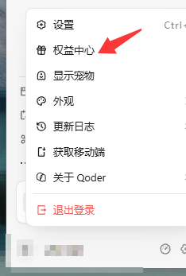
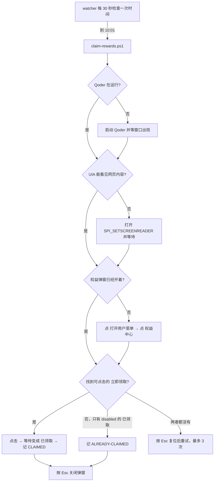

# Qoder 每日权益自动领取

> 每天 10:01 自动打开 Qoder Desktop 的「权益中心」，点掉那个「立即领取」，把 100 Credits 收下。
> 纯 Windows UI 自动化 —— 不逆向接口、不改客户端、不碰登录态。

<p align="center">
  
  &nbsp;&nbsp;&nbsp;&nbsp;
  
</p>

<p align="center">
  <sub>左：账号菜单里的「权益中心」入口（脚本自动点开）。右：弹窗中每天 100 Credits 那行的领取按钮 —— 就是脚本每天 10:01 要按的那一下。</sub>
</p>

<br>

- **适用**：Qoder Desktop（Windows 版）左下角账号菜单里的「权益中心」每日 Credits
- **原理**：Windows UI Automation 按无障碍名称定位控件并触发 `InvokePattern`，等价于你自己用鼠标点了一下
- **幂等**：当天已经领过就直接跳过，不会重复点击
- **零依赖**：只要系统自带的 Windows PowerShell 5.1，不需要 Python / Node / 第三方模块

---

## 目录

- [为什么要做这个](#为什么要做这个)
- [它是怎么工作的](#它是怎么工作的)
- [环境要求](#环境要求)
- [快速开始](#快速开始)
- [文件说明](#文件说明)
- [配置](#配置)
- [日志与退出码](#日志与退出码)
- [手动跑一次 / 试运行](#手动跑一次--试运行)
- [已知限制](#已知限制)
- [故障排查](#故障排查)
- [卸载](#卸载)
- [免责声明](#免责声明)
- [English](#english)

---

## 为什么要做这个

Qoder Desktop 每天 10:00（UTC+8）刷新一次可领取的活动权益，点一下就是 100 Credits，领取后 30 天有效。

问题是它不会自己点。忘了领就是忘了领。

所以写了这个脚本：**把「点开账号菜单 → 点权益中心 → 点立即领取 → 关掉弹窗」这一串人工动作交给系统在每个早上自动做一遍。**

## 它是怎么工作的

### 关键难点：Electron 的界面默认对 UIA 不可见

Qoder Desktop 是 Electron（Chromium）应用。直接遍历它的 UIA 树，你只会拿到几个空壳 `Pane`：

```
Window | Qoder | Chrome_WidgetWin_1
  Pane | Qoder | RootView
    Pane | NonClientView
      Pane | ClientView
        Pane | View
          Pane | View          ← 到此为止，网页内容一个都看不见
```

Chromium 出于性能考虑，**只有在检测到辅助技术时才会构建渲染层的无障碍树**。

解决办法是打开 Windows 的「屏幕阅读器」标志：

```powershell
SystemParametersInfo(SPI_SETSCREENREADER /* 0x0047 */, 0, [ref]$true, SPIF_UPDATEINIFILE | SPIF_SENDCHANGE)
```

大约 3～4 秒后，完整的网页控件树就出来了，而且带着可读的无障碍名称：

```
Button | 打开用户菜单
MenuItem | 权益中心
Button | 立即领取        ← 领过之后变成 Button | 已领取 (IsEnabled = False)
Group  | 可领取奖励
```

拿到这些名字，剩下的就是标准的 UIA 操作：`ExpandCollapsePattern` 展开菜单，`InvokePattern` 点菜单项和按钮。

**因为走的是 Pattern 而不是坐标点击，所以脚本不需要移动你的鼠标、也不需要窗口在前台。**

### 完整流程



### 为什么不去调 HTTP 接口

一开始确实翻了客户端的 `app.asar`。能搜到 `rewardsCenter: "权益中心"` 这类文案，但「立即领取」的按钮文字和请求路径**不在本地包里** —— 权益弹窗的内容是远端下发的，接口形态属于未公开实现。

逆向前端包去拼私有接口，一旦服务端调整就直接失效，而且这类做法通常踩服务条款。**用 UI 自动化模拟自己的点击，行为特征和你手动领是一模一样的**，反而更稳、更干净。

## 环境要求

| 项目 | 要求 |
|---|---|
| 系统 | Windows 10 / 11（依赖 UI Automation 与 System.Drawing 之外的 `user32.dll`） |
| PowerShell | 系统自带的 Windows PowerShell 5.1 即可，无需 PowerShell 7 |
| Qoder | 已安装并已登录 |
| 第三方依赖 | 无 |
| 管理员权限 | **不需要**（调度走 `HKCU\...\Run`，见下文） |

## 快速开始

```powershell
# 1. 克隆
git clone https://github.com/<your-name>/qoder-daily-rewards.git
cd qoder-daily-rewards

# 2. 先空跑一次，确认能找到按钮（不会真的点）
powershell -NoProfile -ExecutionPolicy Bypass -File .\claim-rewards.ps1 -DryRun

# 3. 注册开机自启 + 立刻启动常驻调度
powershell -NoProfile -ExecutionPolicy Bypass -File .\install-autostart.ps1 -StartNow
```

装完之后，每天早上 10:01 它自己就跑了。日志在同目录 `claim.log` / `watch.log`。

<details>
<summary>为什么不用 Windows 计划任务？</summary>

本来首选 `Register-ScheduledTask`（支持从睡眠唤醒、错过自动补跑）。但**普通用户令牌下创建计划任务会被拒**：

```
Register-ScheduledTask : 拒绝访问。  HRESULT 0x80070005
schtasks /Create       →  拒绝访问
```

即使账户名叫 `Administrator`，只要不是提权令牌（`IsInRole(Administrator) = False`）就建不了。

所以这里改用 `HKCU\Software\Microsoft\Windows\CurrentVersion\Run` 注册一个常驻 watcher —— **HKCU 用户可写，不需要提权**。代价是机器整个处于关机状态时不会执行；但从睡眠恢复后，watcher 发现当天目标时间已过会**立刻补跑一次**。

如果你确实想走计划任务（比如需要唤醒睡眠中的机器），提权后执行：

```powershell
schtasks /Create /TN "QoderDailyRewardsClaim" /SC DAILY /ST 10:01 `
  /TR "powershell.exe -NoProfile -ExecutionPolicy Bypass -WindowStyle Hidden -File \"C:\path\to\claim-rewards.ps1\""
```

</details>

## 文件说明

| 文件 | 作用 |
|---|---|
| `claim-rewards.ps1` | 单次领取逻辑。幂等，失败重试 3 次，结束按 Esc 复位弹窗 |
| `claim-watch.ps1` | 常驻调度。每 30 秒比对一次时间，到点拉起一次领取；带互斥锁防多开 |
| `uia-lib.ps1` | UIA 封装：找窗口、按名称搜节点、`Invoke`/`Toggle`/`Expand` 点击、无障碍开关、Esc |
| `labels.json` | 界面上的中文文案。**界面改版只改这个文件，不用动脚本** |
| `install-autostart.ps1` | 写 `HKCU\...\Run` 自启项，可选立即拉起 watcher |
| `uninstall-autostart.ps1` | 删自启项并停掉 watcher 进程 |
| `docs/img/` | 本文档用的截图（账号名已打码） |

## 配置

### 改触发时间

```powershell
# watcher 启动时传 -At（24 小时制）
powershell -File .\claim-watch.ps1 -At "10:30"
```

权益是 10:00 刷新，留 1 分钟余量比较稳。

### 界面文案变了怎么办

Qoder 更新后按钮文字可能变化。所有中文文案都集中在 `labels.json`：

```json
{
  "menuButton": "打开用户菜单",
  "rewardsCenter": "权益中心",
  "claim": "立即领取",
  "claimed": "已领取",
  "dialogMarkers": ["可领取奖励", "专属活动权益"]
}
```

用 [dbg 手法](#找不到按钮) 打印当前 UIA 树里的真实名称，对上以后改这里即可。

> 注意：脚本本体刻意保持**纯 ASCII**，中文一律从 `labels.json` 以 UTF-8 显式读取。因为 Windows PowerShell 5.1 读无 BOM 的 UTF-8 `.ps1` 会把中文按本地代码页解错，导致匹配永远失败。

### 保留无障碍开关

脚本默认只在「进来时发现树是关的」才打开 `SPI_SETSCREENREADER`，跑完**恢复原状**。加 `-KeepA11y` 可以让它保持开启：

```powershell
powershell -File .\claim-rewards.ps1 -KeepA11y
```

## 日志与退出码

`claim.log`（每次领取）与 `watch.log`（调度）都是追加写的 UTF-8：

```
2026-10-26 15:22:03  --- attempt 1/3 ---
2026-10-26 15:22:03  open user menu via pattern:Expand
2026-10-26 15:22:04  open rewards center via pattern:Invoke
2026-10-26 15:22:25  today already claimed
2026-10-26 15:22:25  === ALREADY-CLAIMED ===
```

| 结果 | 退出码 | 含义 |
|---|---|---|
| `CLAIMED` | 0 | 点到按钮且状态翻成「已领取」 |
| `ALREADY-CLAIMED` | 0 | 当天已经领过，跳过 |
| `DRYRUN-CLAIMABLE` | 0 | 空跑，发现可领取但没点 |
| `CLICKED-UNVERIFIED` | 1 | 点了，但 20 秒内状态没变（网络慢或服务端异常） |
| `FAILED` | 1 | 导航失败 / 找不到按钮 |

## 手动跑一次 / 试运行

```powershell
# 空跑：走完导航，只报告会不会点到
powershell -NoProfile -File .\claim-rewards.ps1 -DryRun

# 真跑
powershell -NoProfile -File .\claim-rewards.ps1

# 看 watcher 活着没
powershell -NoProfile -Command "Get-CimInstance Win32_Process -Filter ""Name='powershell.exe'"" | Where-Object { $_.CommandLine -like '*claim-watch.ps1*' } | Select-Object ProcessId"
```

## 已知限制

- **领取那一下的真实点击未在线上验证过。** 写这个脚本当天权益已经领过了，按钮是 disabled 的「已领取」，所以只验证到「导航正确 + 状态判定正确」。点击用的是和导航完全相同的 `InvokePattern` 路径，但第一次真跑建议瞄一眼日志是不是 `CLAIMED`。
- **机器关机时不会执行。** watcher 是用户态进程，不会开机自启到登录之前。（睡眠恢复后会自动补跑。）
- **需要一次交互式登录会话。** UIA 操作的是桌面窗口，锁屏一般仍可执行，但纯后台无人登录的会话不行。
- **会短暂抢焦点。** 权益弹窗打开的约 20 秒里，屏幕上能看到那个窗口；脚本结束时按 Esc 关掉。如果你正好在全屏操作，会有视觉打扰。
- **只覆盖「每天领 100 Credits」这一项。** 弹窗里其他活动是「查看详情」，不在自动化范围内。
- **依赖无障碍名称稳定。** Qoder 改版换文案就要更新 `labels.json`。
- **`SPI_SETSCREENREADER` 是全局设置。** 开启期间，机器上其他 Chromium/Electron 应用也会构建无障碍树，可能带来轻微性能开销。脚本跑完会还原，但如果你在它运行时打开了别的浏览器，会受这个影响。

## 故障排查

### 日志里出现 `renderer a11y still off`

说明无障碍树没建起来。确认 Qoder 真的在运行，然后手动验证：

```powershell
powershell -NoProfile -Command "
Add-Type -Namespace U -Name N -MemberDefinition '[DllImport(\"user32.dll\")] public static extern bool SystemParametersInfo(uint a,uint b,ref bool c,uint d);'
`$v=`$true; [U.N]::SystemParametersInfo(0x0047,0,[ref]`$v,3)"
```

等 5 秒再跑脚本。

### <a id="找不到按钮"></a>找不到按钮

打印当前 UIA 树里所有可点击节点的真实名称，跟 `labels.json` 对：

```powershell
powershell -NoProfile -Command "
. .\uia-lib.ps1
Get-QoderWindows | ForEach-Object {
  Find-AllByName -root `$_ -needle '' |
    Where-Object { 'Button','MenuItem' -contains `$_ .Type } |
    ForEach-Object { '{0,-9} | {1}' -f `$_ .Type, `$_ .Name }
}"
```

### 弹窗没关掉 / 误关了主窗口

脚本用 Esc 关弹窗，**刻意没有用「关闭」按钮** —— 因为 Chromium 的窗口标题栏按钮无障碍名称也是 `关闭`（`ClassName = WinCaptionButton`），按名字点它会直接把 Qoder 关掉。`uia-lib.ps1` 里的 `Find-WebNode` 已经把这类原生按钮过滤掉了，自己改的时候注意别把这个过滤去掉。

### 重复弹窗

watcher 有命名互斥锁 `Local\QoderDailyRewardsClaimWatch`，第二个实例会直接退出。如果怀疑卡住：

```powershell
powershell -File .\uninstall-autostart.ps1   # 停进程 + 删自启
```

## 卸载

```powershell
powershell -NoProfile -ExecutionPolicy Bypass -File .\uninstall-autostart.ps1
```

删掉 `HKCU\...\Run\QoderDailyRewardsClaim` 自启项并停掉 watcher 进程。脚本目录本身可以直接删 —— 它不往系统里装任何东西（`SPI_SETSCREENREADER` 只在运行期间改、跑完还原）。

## 免责声明

这是一个**个人自用**的桌面自动化脚本，作用是替你把每天本来就该自己点一次的那一下点掉。

- 不绕过任何验证码、风控或校验
- 不逆向或调用未公开接口
- 不修改客户端文件、不注入、不破解
- 不给自己多拿额度 —— 每天仍然是那 100 Credits

但请自行确认它与你接受的 Qoder 服务条款不冲突。如果官方明确禁止自动化操作，请停止使用。本项目与 Qoder 官方无关。

MIT 授权，用坏了不负责。

---

## English

A Windows desktop automation that claims the daily **100 Credits** reward inside **Qoder Desktop** every morning at 10:01.

Qoder's rewards center refreshes daily at 10:00 (UTC+8) and offers a claimable credit bundle. This script clicks it for you.

**How it works.** Qoder Desktop is an Electron app. Its renderer content is invisible to Windows UI Automation by default — Chromium only builds the accessibility tree when it detects an assistive technology. The script flips the `SPI_SETSCREENREADER` system flag, waits a few seconds, and the full web control tree appears with readable accessible names (`打开用户菜单`, `权益中心`, `立即领取`). It then drives the UI through `ExpandCollapsePattern` and `InvokePattern`, which means **no cursor movement and no foreground window required**. Finally it presses Esc to dismiss the dialog and restores the system flag.

**Why not hit the API instead?** The claim button's label and request path are not present in the client's `app.asar` — the rewards dialog is server-rendered. Reverse-engineering an undocumented endpoint is brittle and a terms-of-service gray area. Simulating your own click is behaviorally identical to doing it by hand.

**Idempotent.** If today's reward is already claimed the button is present but disabled, and the script logs `ALREADY-CLAIMED` and exits 0.

**Scheduling.** Windows Task Scheduler requires elevation, which a UAC-filtered token does not have even when the account is literally named `Administrator` (`schtasks /Create` returns `Access is denied`, `0x80070005`). So the watcher registers itself under `HKCU\...\Run` instead — no admin needed — and loops on a 30-second tick. It cannot run while the machine is powered off, but it does catch up after wake-from-sleep.

**Requirements:** Windows 10/11, the built-in Windows PowerShell 5.1, Qoder installed and logged in. No third-party modules.

**Caveat:** the actual claim click has not been verified against a live claimable button — the reward was already claimed on the day this was written, so only navigation and state detection were exercised end to end. Check `claim.log` after the first real run; you want to see `CLAIMED`.

All UI strings live in `labels.json`, so a Qoder redesign needs an edit there rather than in the scripts. The `.ps1` sources are deliberately pure ASCII because Windows PowerShell 5.1 mis-decodes BOM-less UTF-8 script files.

## License

MIT
